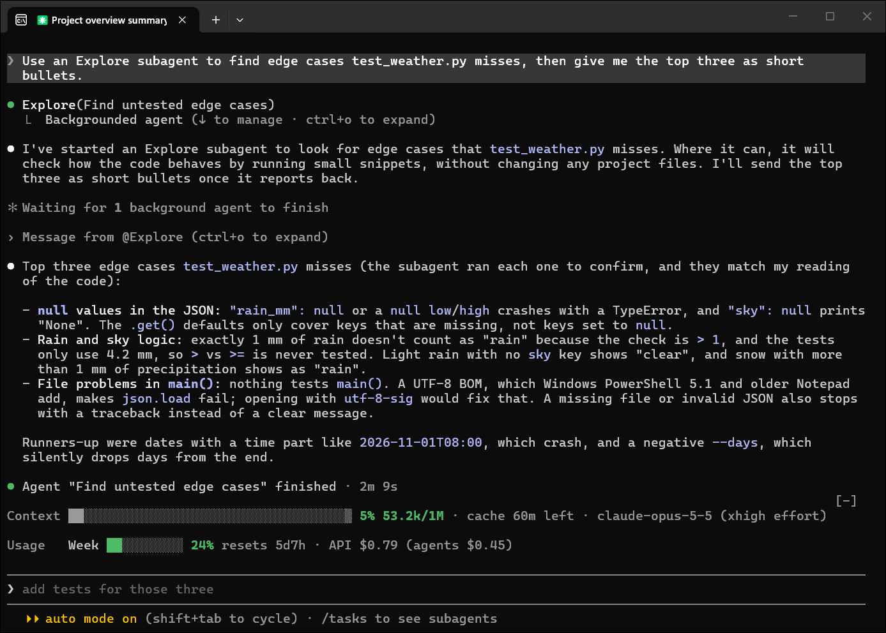

# context-bar

A minimalistic mod that shows your current context window usage, the cache TTL timer and total API equivalent cost for the current session.



## Install
```
claude plugin install context-bar --marketplace TheHighestBit/context-bar
```

or from within Claude Code:

```
/plugin install context-bar --marketplace TheHighestBit/context-bar
```

To turn on auto-update: run `/plugin`, open the **Marketplaces** tab, select `context-bar` and choose **Enable auto-update**. To update by hand:

```
claude plugin update context-bar@context-bar
```

then run `/reload-plugins` or restart Claude Code.

## Commands

| Command | What it does |
| --- | --- |
| `/context-bar` | Cycles between bar → legend → off. |
| `/context-bar bar` · `legend` · `off` | Picks one directly. |
| `/context-bar ttl` | Says what the cache TTL is, how it was decided, and how long the cache has left. |
| `/context-bar agents` | Lists what each subagent cost this session in API equivalent pricing. |
